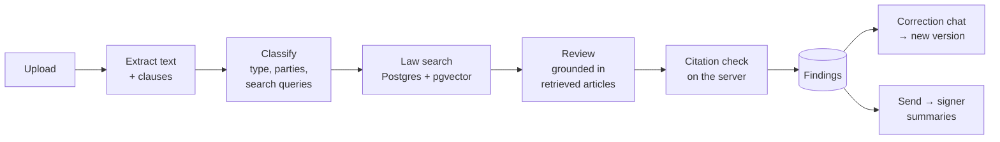

# Cralex

AI legal review and e-signature for Uzbek contracts.

- **Check a contract.** Upload a PDF, DOCX or text file. The AI reads it against Uzbek legislation and lists
  the problems, each with its clause, how severe it is, what to change, and the law article it rests on.
- **Fix it in a chat.** Ask for changes in plain words ("make the deposit refundable"). The AI proposes exact
  edits. Accepting them writes a new version of the Word file, and that version is reviewed again automatically.
- **Ask a legal question.** Describe a situation ("my employer hasn't paid me for two months"). You get the
  answer, what the law says (with articles), the steps to take, where to go and, when needed, a template to fill in.
- **Send it for signature.** Place fields on the PDF, add people, and send. Each person gets a link, reads a
  plain-language summary of what they are agreeing to (their duties, deadlines, what to watch out for), fills in
  and signs **their own copy**, and gets a sealed PDF with a verifiable certificate.

The interface is in Uzbek.

## How the AI stays honest

- **Grounded in real law.** Every AI call gets articles retrieved from an index of Uzbek legislation
  (lex.uz + an open corpus, ~190k article parts, keyword + vector search). The model may only cite articles it
  was given, and the server checks it: a citation that was not retrieved is dropped (`citation: null`) instead
  of shown as a guess.
- **Documents are data.** Contract text and questions are fenced as data in every prompt, so a contract that
  says "ignore your instructions" is reported, not obeyed.
- **Structured output only.** Every answer comes back as JSON against a Zod schema and is validated again on
  the server. Raw model output never reaches the browser.
- **Measured.** `pnpm eval:review` scores citation accuracy and issue precision on labelled cases, and
  `pnpm --filter api eval:search` scores law search (recall@10 ≈ 99% on 102 queries with hybrid search).
- **The signing path never calls the model.** The summary a signer reads was written when the document was sent
  and is stored with a hash, so everyone signs against the same text.



All AI work runs as BullMQ jobs: a request returns an id at once and the page polls for the result, so a slow
model call never blocks a request, and every job is safe to retry.

## Apps

| App         | What                                                          | Port |
| ----------- | ------------------------------------------------------------- | ---- |
| `apps/web`  | Next.js dashboard (Q&A, upload, AI review, send for signature) | 3000 |
| `apps/sign` | Next.js public signing app for receivers (no login)           | 3001 |
| `apps/api`  | NestJS backend, AI jobs, law index, Drizzle ORM               | 5000 |
| Postgres    | Postgres 18 + pgvector (Docker)                               | 5434 |
| Redis       | BullMQ jobs (Docker)                                          | 6391 |

| Package              | What                                                                |
| -------------------- | ------------------------------------------------------------------- |
| `packages/contracts` | Zod schemas shared by the API and the frontends, plus sample responses |
| `packages/crypto`    | Canonical hashing, Ed25519 seals and the signing certificate        |
| `packages/theme`     | Colour tokens (light + dark) and shared button styles               |

Stack: TypeScript, NestJS, Next.js, Drizzle ORM, PostgreSQL + pgvector, Redis + BullMQ, OpenAI (Responses API,
structured outputs), Voyage embeddings, pdf-lib / pdf.js, Tailwind CSS, Turborepo + pnpm.

## Getting started

Requires Node 24+, pnpm and Docker.

```bash
pnpm install
cp apps/api/.env.example apps/api/.env
cp apps/web/.env.example apps/web/.env.local
cp apps/sign/.env.example apps/sign/.env.local
pnpm services:up      # Postgres (5434) + Redis (6391) in Docker
pnpm db:migrate       # apply the Drizzle migrations
pnpm dev              # all three apps (or pnpm dev:api / dev:web / dev:sign)
```

Open http://localhost:3000/register and create an account (the free plan has 3 contract checks).

In `apps/api/.env`:

- `OPENAI_API_KEY`: needed for the AI review, the legal Q&A and the signer summaries.
- `JWT_SECRET`: 32+ random characters (`openssl rand -base64 48`).
- `SEAL_KEYS`: the key ring that seals signed copies. Run `pnpm --filter api seal:keygen` and paste the line it
  prints. Without it a signed copy is never sealed. Never delete a key once copies are sealed with it.
- `SIGN_TICKET_SECRET`: signs password tickets (optional in development, required in production).
- `STORAGE_DRIVER=local|r2` (default `local`); for `r2` also `S3_ENDPOINT`, `S3_BUCKET`, `S3_ACCESS_KEY_ID`,
  `S3_SECRET_ACCESS_KEY`.
- `SIGN_APP_URL` (default `http://localhost:3001`): the host signing links point to.
- `RESEND_API_KEY` (optional): emails signing invites through Resend; without it they are only logged.
  `MAIL_FROM` is the sender address.
- `VOYAGE_API_KEY` (optional): embeddings for hybrid law search; without it search is keyword only.

### Law data

With empty law tables the API answers from a small set of built-in fixture articles, which is enough to try the
flow. For real answers, load the legislation:

```bash
# download the corpus to apps/api/data/hf/articles.parquet first:
# https://huggingface.co/datasets/sukhrobnurali/uzbek-legal-corpus (articles)
pnpm ingest:hf                      # the open corpus
pnpm --filter api ingest:core       # the core codes from lex.uz, current edition (~6 min)
pnpm --filter api ingest:embed      # optional: embeddings for hybrid search (VOYAGE_API_KEY)
```

### Tests

```bash
pnpm test                           # unit + integration tests (in-process Postgres, no Docker needed)
pnpm --filter api test:e2e          # boots the whole API; needs pnpm services:up
pnpm lint
pnpm eval:review                    # AI review quality on labelled cases (spends OpenAI tokens)
```

Routes, errors and the code layout of the API are in [`apps/api/README.md`](apps/api/README.md).

## Current limits

- Payments are in **test mode**: choosing a plan activates it at once and no money is taken. Payme and Click
  are not connected yet.
- Signing invites are delivered by **email**. Telegram and SMS recipients are saved, and the sender shares their
  link by hand.
- Only a PDF can be sent for signature, and only a Word file can be edited by the AI (other formats get the
  suggested text to copy).
- The AI output is a risk review and general legal information, not legal advice.

## Deployment (Railway)

Five services in one Railway project. Each app builds from the repo root with its own Dockerfile.

| Service    | Source                                  | Public | PORT |
| ---------- | --------------------------------------- | ------ | ---- |
| `api`      | `docker/api.Dockerfile`                 | no     | 5000 |
| `web`      | `docker/web.Dockerfile`                 | yes    | 3000 |
| `sign`     | `docker/sign.Dockerfile`                | yes    | 3001 |
| `postgres` | image `pgvector/pgvector:pg18` + volume | no     | 5432 |
| `Redis`    | Railway Redis                           | no     | 6379 |

- The browser never calls the API directly: `web` forwards `/api/*` to `API_URL` (a rewrite in
  `apps/web/next.config.ts`), so the refresh cookie stays first-party. Set `NEXT_PUBLIC_API_URL=/api` on `web`
  and `REFRESH_COOKIE_PATH=/api/auth` on `api`. Both `NEXT_PUBLIC_API_URL` and `API_URL` are read at build time on `web`.
- `sign` forwards `/api/sign/*` to `API_URL` at runtime. `web` and `sign` reach the API over the private network
  (`http://api.railway.internal:5000`).
- `api` runs `docker/api-predeploy.sh` (Drizzle migrations) before each deploy and is health-checked on `/health`.
- `PORT` is pinned on every service to the Dockerfile's `EXPOSE`, so the edge proxy and the app agree.
- Deploy a service from a local checkout with `railway up --service <name>`; `.railwayignore` keeps `.env` files
  and local data out of the upload.
